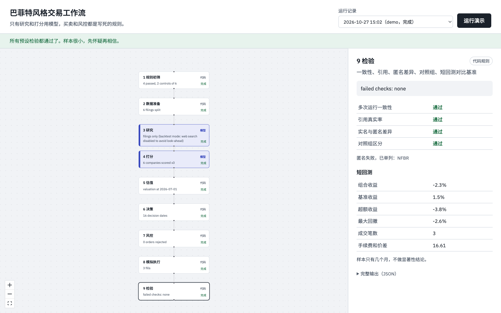

# 巴菲特风格交易 Agent 工作流

一条可检验的交易agent工作流：规则初筛 → 数据准备 → 研究 → 打分 → 估值 → 决策 → 风控 → 模拟执行 → 检验。
只有研究和打分调用模型（DeepSeek），买卖和风控全部是写死的代码规则，每一步的输入输出都存档。



*演示数据（6家虚构公司）的运行结果。点画布上任意一步，右侧显示它的输入输出。*

## 快速开始（不需要网络和API密钥）

```bash
cd backend
pip install -r requirements.txt
python -m unittest -v          # 23个离线测试
python -m buffett_agent demo   # 用6家虚构公司跑完整流程
```

演示数据全部是虚构的公司、文件和价格，专门用来触发各种失败路径：

| 演示里发生的事 | 验证的是什么 |
| --- | --- |
| HLNF 的一条引用是编造的，对应分数被置空，公司不交易 | 引用核对，失败即不交易 |
| NFBR 匿名后仍被模型猜中 | 匿名泄露检查，单列不计入 |
| CPLF 实名比匿名高分 | 模型“记忆”带来的偏差 |
| CPLF 质量高但太贵，没有买 | 估值门槛 |
| RRSV 8月下跌约25%，触发止损 | 止损规则 |
| 止损后一周又被判定“便宜” | 冷却期规则（见下） |
| 2026年9月提交的财报重述被忽略 | 按时点取数 |

## 界面

```bash
# 终端1
cd backend && uvicorn buffett_agent.api:app --reload --port 8000
# 终端2
cd web && npm install && npm run dev     # 打开 http://localhost:5173
```

点“运行演示”，在画布上点任意一步查看它的输出。模型步骤用靛蓝色标出。

## 真实数据

```bash
export SEC_USER_AGENT="Your Name you@example.com"   # SEC要求，必填
export DEEPSEEK_API_KEY=...
cp config.example.yaml config.yaml                    # 跑之前把阈值定死
# prices/ 目录放每只股票一个CSV：date,open,close（已复权），以及 SPY.csv
python -m buffett_agent backtest --tickers KO,PG,... --sectors KO=Staples,PG=Staples \
    --as-of 2026-07-01 --end 2026-10-23 --model-cutoff <模型训练截止日> --prices-dir prices
```

回测开始日早于 `--model-cutoff` 会直接报错，避免训练数据泄露带来的虚高。

**默认股票池是标普500**：不给 `--tickers` 时，筛选 `data/sp500.csv` 里在 `--as-of` 当天已经入选的成分股，行业用 GICS 分类，不用再写 `--sectors`。
SEC 限速约每秒8次，第一次跑500家要下载十几分钟，之后走 `.cache/edgar` 缓存。拿不到数据的公司会跳过，原因记在第1步输出的 `skipped` 里。
`prices/` 里需要有这些股票的价格CSV，没有价格的公司不会成交。

初筛阈值可以在界面上点“1 规则初筛”修改，每次运行都会记下用了哪组阈值。

## 代码结构

```
backend/buffett_agent/
  config.py            所有阈值，每次运行都存档
  data/edgar.py        SEC客户端：User-Agent、限速、只取决策日之前的文件
  data/xbrl.py         按时点的财务指标；记录用了哪个XBRL标签
  data/sections.py     10-K切段（跳过目录里的重复标题）
  data/prices.py       价格；下一个开盘价成交
  data/universe.py     默认股票池：标普500成分股（sp500.csv，2026-10-27快照）
  screening.py         第1步 规则初筛 + 对照组抽样
  research/scoring.py  第4步 模型打分：JSON校验、重试、失败即不交易
  research/citations.py 引用逐字核对，无可验证证据的分数置空
  research/anonymize.py 匿名化 + 泄露检查
  trading/valuation.py 第5步 所有者盈余收益率
  trading/decision.py  第6步 买入/持有/卖出规则，记录触发的规则
  trading/risk.py      第7步 仓位、行业、新开仓上限，一键停止
  trading/broker.py    第8步 模拟盘，扣佣金和价差
  trading/backtest.py  短回测：截止日保护、按时点、对比SPY
  checks.py            第9步 一致性、引用率、匿名差异、对照组
  pipeline.py          串起9步，每步存档
  api.py / __main__.py HTTP接口和命令行
web/                   React + React Flow 画布
```

## 已知局限（报告里要写）

- 只取最近一份10-K；EDGAR submissions 里更早的分页文件没有翻页。
- 标普500名单是今天的快照：`--as-of` 之后才入选的会被排除，但之前已经被剔除的公司不在名单里，有幸存者偏差。要彻底解决，得换成历史成分股名单。
- 美债收益率是常数参数，正式回测前要换成按日期的序列。
- yfinance 不含已退市股票，有幸存者偏差。
- 往前跑的模拟盘（持仓跨周持久化、联网调研）还没实现，`research` 一步在回测模式下只读文件。
- XBRL 标签映射只覆盖常见标签，需要抽查核对。
- 本仓库在没有网络的环境里写成：FastAPI 接口和前端没有在这里实际运行过，核心逻辑有离线测试覆盖。

## 一个检验里发现的问题

第一次跑演示时，RRSV 触发止损卖出后，一周后又被重新买回：价格更低让估值看起来更“合适”。
止损和“便宜就买”这两条规则互相打架。现在加了 `reentry_cooldown_days`（默认90天）冷却期，
这个设定本身也是待决问题，报告里应分别统计止损卖出和基本面卖出的结果。
